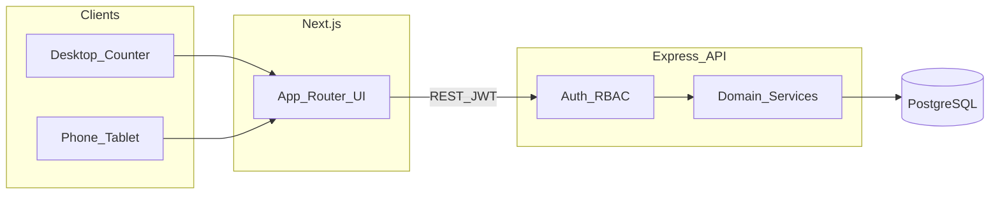
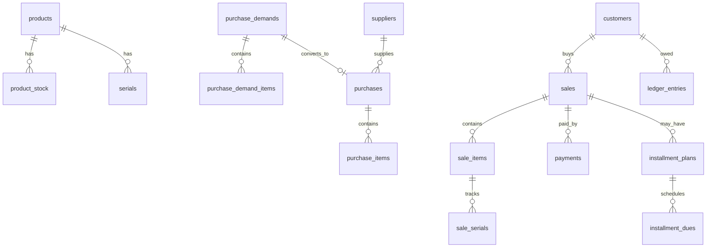

# Hardware Shop POS — Full Build Plan

## 1. Goal

Build POS / billing software for one hardware shop selling TVs, monitors, laptops, CCTV cameras, accessories, and cables. Staff use it on a desktop counter and on phone/tablet on the floor.

## 2. Locked decisions

| Decision | Choice |
|----------|--------|
| Backend | Express.js (REST JSON API) |
| Database | PostgreSQL |
| Data access | No ORM — `pg` Pool + parameterized SQL + versioned SQL migrations |
| Frontend | Next.js (App Router) + TypeScript |
| Shop setup | **Single location** (no multi-branch in v1) |
| Selling style | Cash/card/MFS **+ credit (due) + installment/EMI** |
| Sale modes | **Retail + wholesale**, **backdate sale entry**, **item exchange** |
| Currency | BDT |
| Scanning | Barcode + QR (USB scanner + phone camera) |
| Auth | JWT access + refresh; bcrypt passwords |

## 3. Will this fulfill the business?

**Yes for core operations:** retail/wholesale sell, backdate entry, exchange, stock, serials, purchase demand → purchase, invoices, due collection, EMI, returns, warranty log, expenses, reports.

**Add later if you feel the gap:** SMS/WhatsApp reminders, pending delivery, booking advance, salesman commission, supplier return, offline mode, formal BD VAT/mushak. Not required to open on this v1.

---

## 4. Full feature list (v1)

### 4.1 Auth & shop setup
- Login / logout / refresh session
- Roles: `admin`, `manager`, `cashier`, `stock`
- Permissions: discount, void, see cost, approve return, **wholesale price**, **backdate sale**, manage users
- Shop profile: name, logo, address, phone, VAT/TIN

### 4.2 Catalog (hardware-focused)
- Categories (TV, Monitor, Laptop, CCTV, Accessory, Cable, …)
- Brands
- Products (one row per sellable SKU): SKU, barcode, name, category, brand, unit, cost, **retail price**, **wholesale price**, tax %, reorder level, warranty months, serial-required flag
- Unique barcode per product (EAN/UPC/Code128 or shop QR payload = same string)
- Optional product image; CSV bulk import
- Print barcode/QR product labels (browser print)

### 4.3 Purchase demand (low stock → demand list → order)
- **Low-stock demand list:** products at/below reorder level (current qty, reorder level, suggested qty)
- **Create purchase demand order** from selected low-stock items and/or manual add of any product
- Demand order fields: demand no (`DEM-YYYY-######`), date, notes, optional preferred supplier, lines (product, requested qty, last cost)
- Status flow: `draft` → `ordered` → `partially_received` / `received` / `cancelled`
- Convert demand order → **purchase / goods receive** (copy lines; link `purchase.demand_id`); receiving updates demand status
- Print / export demand list for supplier

### 4.4 Suppliers & purchasing
- Supplier CRUD
- Purchase / goods receive: items, cost, invoice (standalone or from demand order)
- Stock increases on receive (DB transaction)
- Supplier due + supplier payments

### 4.5 Inventory
- Shop-wide stock quantity
- Stock adjustments (damage/lost) with reason + audit
- Low-stock alerts (feeds purchase demand list)
- Serial / IMEI / device ID for TV, laptop, CCTV, etc.
- Serial status: `in_stock | sold | returned | defective`

### 4.6 Customers
- Name, phone (unique), address, NID optional
- Credit limit + current due balance
- Purchase history
- POS search by phone

### 4.7 POS / billing (sale item + wholesale + backdate)
- Fast search: name, SKU, barcode
- **Sale type:** `retail` | `wholesale` — cart lines use retail or wholesale price; manager can still override with permission
- Cart: qty, price override (permission), line/bill discount, tax
- **Barcode / QR scan → add to cart**
  - Desktop: USB/Bluetooth scanner (keyboard wedge) → lookup → add line
  - Phone/tablet: camera scan (1D + QR)
  - Unknown code → error; same code again → increase qty
- Attach serials when product requires them
- Payments: Cash, Card, MFS (bKash/Nagad/Rocket labels), Mixed, Credit, Installment
- Hold / recall bill
- Invoice numbers: `INV-YYYY-######`
- **Backdate sale entry** (permission-gated): set `sale_date` to a past date when recording a missed/paper bill; audit log records who backdated and the original system time; reports use `sale_date`
- Print invoice (A4 browser print; 80mm thermal later)
- Cashier shift open/close with cash summary

### 4.8 Credit / due sales
- Partial pay now + remaining due
- Customer ledger (debit/credit)
- Collect due later (allocate to invoices)
- Due aging report

### 4.9 Installments / EMI
- Plan on sale: down payment + N months
- Schedule with due dates
- Record installment payments
- Overdue list (SMS reminders later)

### 4.10 Returns, exchange & warranty
- Return against invoice (full/partial); restock or mark defective
- **Exchange item:** against original invoice (or walk-in with permission)
  - Return old item(s) to stock or mark defective (serial status updated)
  - Add new item(s) to cart at retail/wholesale price
  - Net payable = new total − returned value (− optional exchange fee/discount)
  - One exchange document linked to original sale + new sale/credit note lines; stock moves in one transaction
- Warranty from sold serial + expiry date
- Warranty claim log: repair / replace / reject (no full service-center module)

### 4.11 Expenses
- Categories (rent, salary, utility, transport, …)
- Record expense with date/note

### 4.12 Reports & dashboard
- Today sales; cash / card / MFS / due split; **retail vs wholesale** split
- Sales by product / category / brand / cashier
- Profit estimate (sell − cost), permission-gated
- Stock valuation, low stock, serial inventory
- Open purchase demands; purchase & supplier dues
- Customer dues & installment overdue; exchanges summary
- Date-range filters + CSV export (by `sale_date`)

### 4.13 Audit & safety
- Activity log: voids, discounts, stock adjusts, price changes, **backdated sales**, **exchanges**
- Soft-delete where safe; never hard-delete sold serials/invoices
- Document DB backups (`pg_dump`)

### 4.14 Out of scope for v1 (later)
- Multi-branch / stock transfer
- SMS/WhatsApp invoice + EMI reminders
- Pending delivery / booking advance
- Salesman commission
- Supplier purchase returns
- Offline-first sync
- Full accounting package
- E-commerce storefront
- Formal BD mushak/VAT challan pack
- Hardware cash-drawer ESC/POS drivers

---

## 5. Architecture

**Repo layout**
- `backend/` — Express API, SQL migrations, raw query modules
- `frontend/` — Next.js UI (responsive; POS optimized for touch)

**Backend conventions**
- `pg` Pool + parameterized SQL only
- Versioned migrations in `backend/migrations/`
- Thin routers → service layer → query modules
- DB transactions for sale, purchase, return, due collection, installment payment
- JWT + role middleware: `admin | manager | cashier | stock`

**Frontend conventions**
- Business calls go to Express REST (Next is UI)
- Role-gated menus; large tap targets on POS
- Invoice print via browser print CSS

---

## 6. Core data model

**Main tables:** `shop_settings`, `users`, `categories`, `brands`, `products` (retail + wholesale price), `product_stock`, `serials`, `suppliers`, `purchase_demands`, `purchase_demand_items`, `purchases`, `purchase_items`, `customers`, `sales` (`sale_type`, `sale_date`, `is_backdated`), `sale_items`, `sale_serials`, `payments`, `customer_ledger`, `installment_plans`, `installment_dues`, `returns`, `return_items`, `exchanges`, `exchange_items`, `warranty_claims`, `expenses`, `audit_logs`, `shifts`.

No `branches` table in v1. Can add `branch_id` later if you expand.

---

## 7. Build phases (implementation order)

| Phase | Deliverable |
|-------|-------------|
| **0** | Scaffold backend + frontend, Postgres, migration runner, env, health check |
| **1** | Auth, users, roles, shop settings |
| **2** | Catalog + stock + serials + low-stock + barcode/QR labels |
| **3** | Suppliers + **purchase demand list/orders** + purchases + stock-in |
| **4** | Customers + POS + **retail/wholesale** + **backdate sale** + barcode/QR + payments + invoice |
| **5** | Credit ledger + due collection |
| **6** | Installments / EMI |
| **7** | Returns + **exchange items** + warranty claims |
| **8** | Expenses + dashboard/reports + CSV |
| **9** | Camera-scan polish, shifts, hardening |

Ship **Phases 1–4** first so you can sell and manage stock; then credit → EMI → returns → reports.

Each phase = working API **and** UI screens.

---

## 8. Key screens (Next.js)

- Login
- Dashboard
- POS (full-screen cart) — retail/wholesale toggle, backdate (if allowed), scan
- Products / stock / serials / label print
- Low-stock demand list · Purchase demand orders
- Purchases / suppliers
- Customers / due / installments
- Sales history / invoice detail / return / **exchange**
- Expenses
- Reports
- Settings (users, shop, tax)

---

## 9. How we implement (after you approve)

1. Scaffold `backend` (Express + `pg` + migration CLI) and `frontend` (Next.js + TypeScript).
2. Write SQL migrations for the schema above.
3. Implement phases in order; seed demo data (admin user + sample TV/monitor/laptop/CCTV SKUs).
4. Defaults: BD phone validation, invoice `INV-YYYY-######`, configurable tax %, cost/profit hidden from cashier.

---

## 10. Success criteria for v1

- Cashier can scan or search a product, sell retail (or wholesale if allowed) with serial, take mixed payment, print invoice
- Manager can backdate a missed sale, exchange an item, build purchase demand → purchase, collect dues, manage EMI
- Admin can manage users, see profit reports, audit backdates/exchanges
